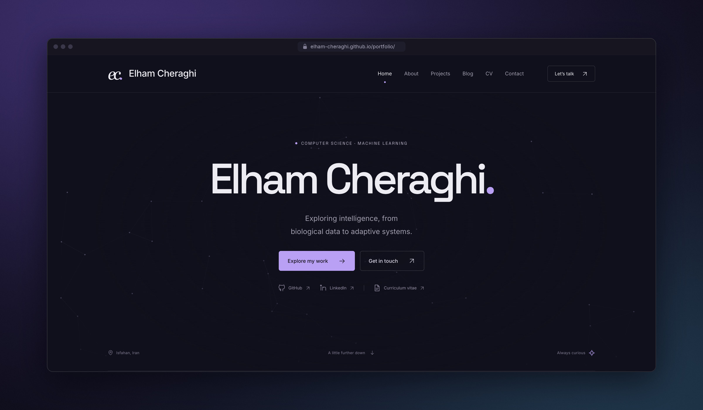
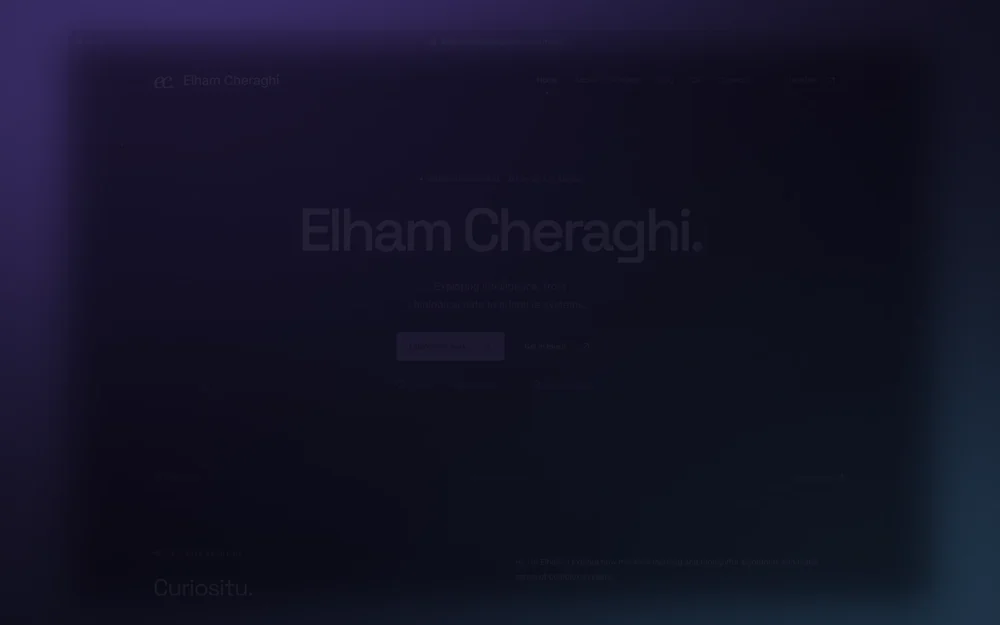
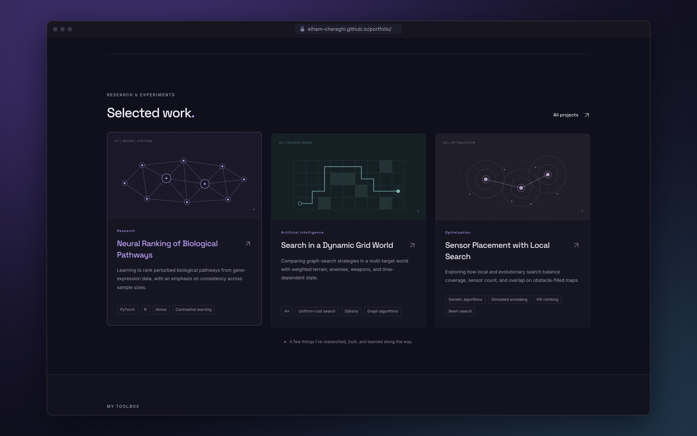
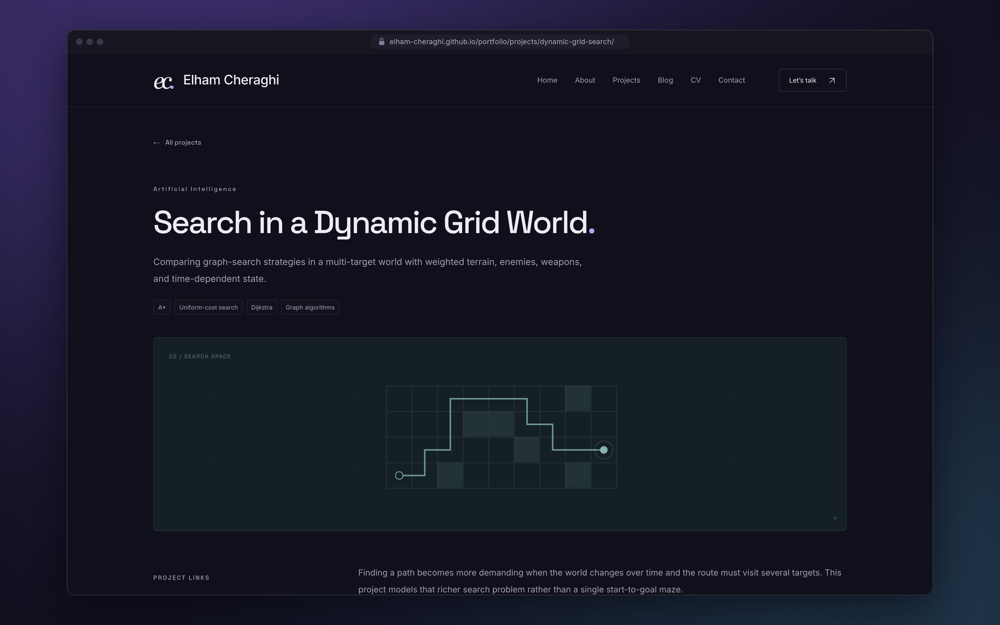
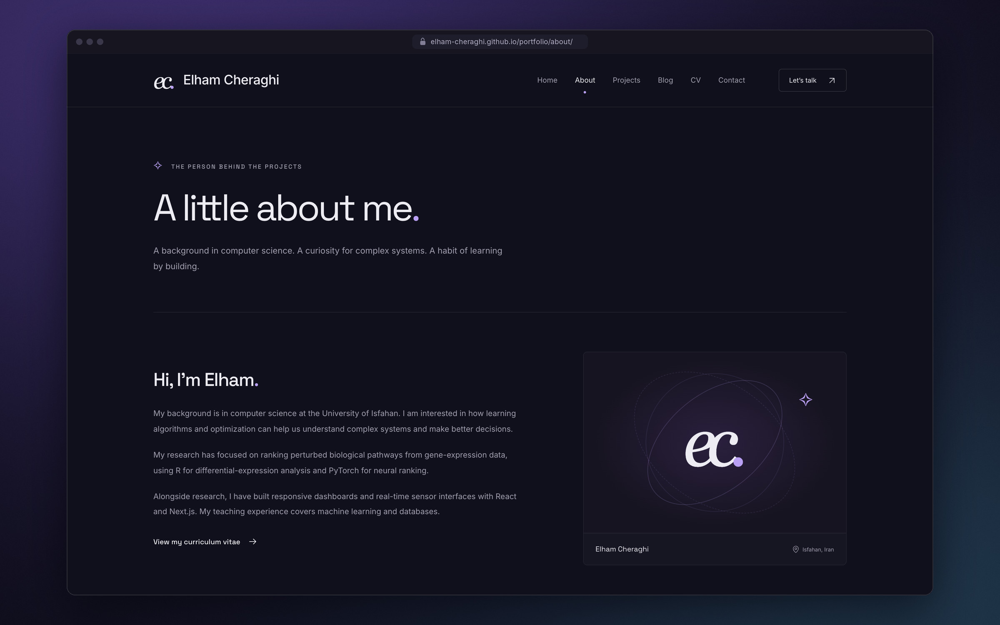
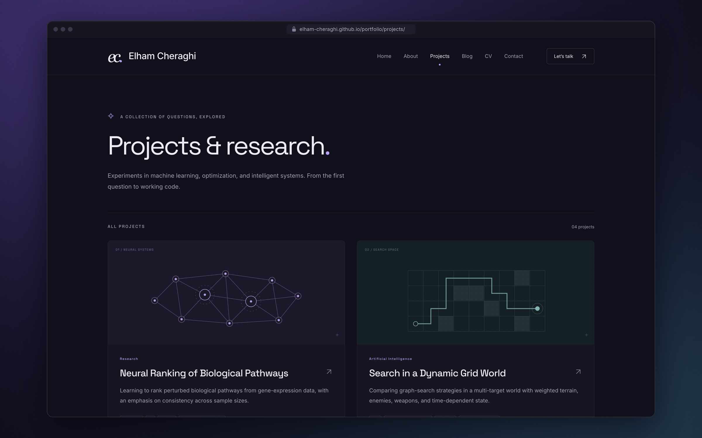
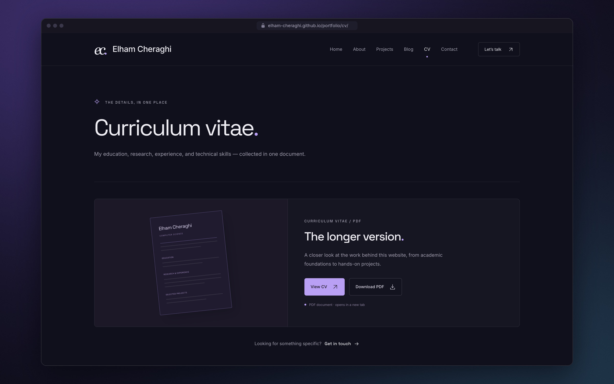
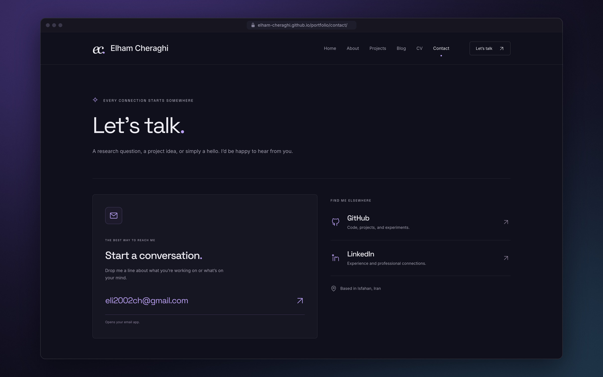
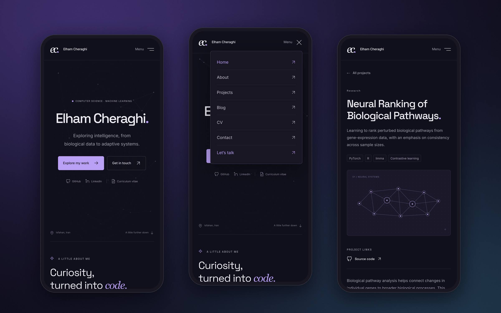

<div align="center">



<br>

# Elham Cheraghi

**A personal portfolio for research, projects, writing, and a CV.**

Computer science · machine learning · search and optimization

<br>

[Visit the site](https://elham-cheraghi.github.io/portfolio/) &nbsp;·&nbsp; [Projects](https://elham-cheraghi.github.io/portfolio/projects/) &nbsp;·&nbsp; [Curriculum vitae](https://elham-cheraghi.github.io/portfolio/cv/) &nbsp;·&nbsp; [Get in touch](https://elham-cheraghi.github.io/portfolio/contact/)

<br>


</div>

<br>

## A short tour

<div align="center">

<a href=".github/media/demo.mp4">
  
</a>

<sub>The first thirty seconds, on a loop. <a href=".github/media/demo.mp4">Watch the full tour</a> in high quality (1 min).</sub>

</div>

<br>

## About

This is the source of my personal website: a quiet place to collect the research I have done, the projects I have built, and the things I am still curious about.

The design keeps out of the way. It uses a deep ink background, a single lavender accent, and two typefaces: Space Grotesk for headings and Inter for reading. Each project has its own small illustration drawn in SVG, and a slow field of connected points moves behind the home page. Pages are static HTML with almost no JavaScript, so they load quickly and read well on any screen.

<br>

## Pages

<table>
  <tr>
    <td width="50%"><p align="center"><sub><b>Selected work</b> &nbsp;·&nbsp; featured projects on the home page</sub></p></td>
    <td width="50%"><p align="center"><sub><b>Project</b> &nbsp;·&nbsp; a write-up with its own illustration</sub></p></td>
  </tr>
  <tr>
    <td width="50%"><p align="center"><sub><b>About</b> &nbsp;·&nbsp; background, education, and experience</sub></p></td>
    <td width="50%"><p align="center"><sub><b>Projects</b> &nbsp;·&nbsp; every project in one place</sub></p></td>
  </tr>
  <tr>
    <td width="50%"><p align="center"><sub><b>Curriculum vitae</b> &nbsp;·&nbsp; view in the browser or download as PDF</sub></p></td>
    <td width="50%"><p align="center"><sub><b>Contact</b> &nbsp;·&nbsp; email, GitHub, and LinkedIn</sub></p></td>
  </tr>
</table>

<br>

## On small screens



Every page is designed for narrow screens as well as wide ones. On phones, the navigation folds into a menu that closes on <kbd>Esc</kbd> or on a tap outside it.

<br>

## What's inside

- **Home**: an introduction, featured projects, a toolbox of skills, and a closing invitation to get in touch.
- **Projects**: research and coursework written in Markdown, each with its technologies, links to source code, and an illustration.
- **Blog**: ready for writing. Posts marked as drafts stay out of the published site.
- **CV**: a PDF you can open in the browser or download.
- **About** and **Contact**: background, education, experience, and ways to reach me.
- **The details**: canonical URLs, Open Graph cards, a sitemap, `robots.txt`, a custom 404 page, keyboard focus styles, a skip link, and full support for `prefers-reduced-motion`.

<br>

## Built with

| | |
|---|---|
| **Framework** | [Astro](https://astro.build), with static output and content collections |
| **Styling** | [Tailwind CSS](https://tailwindcss.com) v4 and a small hand-written stylesheet |
| **Language** | TypeScript |
| **Type** | Space Grotesk and Inter, self-hosted as WOFF2 |
| **Hosting** | GitHub Pages, deployed by GitHub Actions |

There are only two small scripts: one for the mobile menu, and one for the particle field on the home page. The particle field is a canvas that pauses when it scrolls out of view and stays still when reduced motion is preferred.

<br>

## Running locally

You need Node.js 22.12 or newer.

```bash
npm ci
npm run dev        # http://localhost:4321
```

| Command | What it does |
|---|---|
| `npm run dev` | Starts the development server |
| `npm run check` | Type-checks the Astro components and TypeScript |
| `npm run build` | Builds the static site into `dist/` |
| `npm run preview` | Serves the built site locally |
| `npm run verify` | Checks the build: links, titles, descriptions, canonical URLs, drafts, and the sitemap |

<br>

## Editing content

Most changes need only a single file.

| To change | Edit |
|---|---|
| Name, tagline, bio, skills, education, social links | `src/config/site.ts` |
| Work and teaching experience | `src/data/experience.ts` |
| Projects | `src/content/projects/*.md` |
| Blog posts | `src/content/blog/*.md` |
| The CV | `public/cv.pdf` |
| Colours and typefaces | the `@theme` block in `src/styles/global.css` |

A project is a Markdown file with a short header:

```yaml
---
title: Search in a Dynamic Grid World
description: Comparing graph-search strategies in a multi-target world.
technologies: [A*, Uniform-cost search, Dijkstra]
category: Artificial Intelligence
featured: true          # show it on the home page
repository: https://github.com/...
visual: search          # pathways · search · sensors · logic
order: 2
---
```

Blog posts take a `title`, `description`, `pubDate`, and optional `tags`. Set `draft: true` to keep a post out of the published site.

<br>

## Project structure

```text
.
├── public/                 static files: CV, fonts, favicon, social card
├── scripts/verify.mjs      checks run against the built site
├── src/
│   ├── components/         header, footer, project cards, illustrations
│   ├── config/site.ts      profile details and navigation
│   ├── content/            projects and blog posts in Markdown
│   ├── data/               experience
│   ├── layouts/            the shared page layout and metadata
│   ├── pages/              one file per route
│   └── styles/global.css   theme and styles
└── astro.config.mjs
```

<br>

## Deployment

Every push to `main` runs the workflow in `.github/workflows/deploy.yml`. It type-checks, builds, verifies the output, and publishes to GitHub Pages.

The site URL and base path are worked out from the repository name, so the same code works at `username.github.io/portfolio/` or at the root of a custom domain. For a custom domain, set two repository variables under **Settings → Secrets and variables → Actions**:

```bash
PUBLIC_SITE_URL=https://www.example.com
PUBLIC_BASE_PATH=/
```

For local builds, the same values can go in a `.env` file. See `.env.example`.

<br>

---

<div align="center">
<sub>Designed and built by <a href="https://github.com/elham-cheraghi">Elham Cheraghi</a> &nbsp;·&nbsp; Isfahan, Iran</sub>
<br>
<sub>Inter and Space Grotesk are used under the SIL Open Font License.</sub>
</div>
